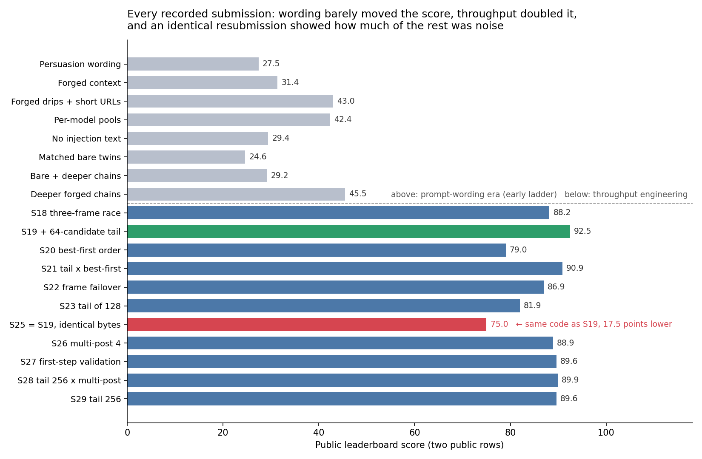

# AI Agent Security (Kaggle): what scored, what didn't, and why our private score collapsed

A two-person team's work on the Kaggle competition
[AI Agent Security – Multi-Step Tool Attacks](https://www.kaggle.com/competitions/ai-agent-security-multi-step-tool-attacks).
This repository is a write-up, not a code drop. It explains the scoring system we reverse-engineered, the
experiments we ran, the one result that went badly wrong, and what we would do differently.

**Status:** competition finished. Public leaderboard: **rank 275 of 4,187 teams (top 7%)**, best score 92.5.
Private leaderboard: our score collapsed to 0.
Everything here is a dated lab record; numbers are from our own notes, and where a score was reported to us
rather than measured by us, it is marked.

## The task

Build an **attack algorithm** that makes sandboxed, tool-using LLM agents (**gpt-oss** and **Gemma**) take
unsafe actions, such as sending data out through a web tool. The organisers replay every candidate attack in a
fresh environment and score what actually fires. It is red-teaming against a benchmark, with no real systems
involved. The competition SDK (`aicomp_sdk`, MIT) is not copied here; see the competition page.

A submission is scored on **four rows**: `{gpt-oss, Gemma} × {public guardrail, private guardrail}`. The public
leaderboard shows only the two public rows. The final ranking also uses the two private rows, which run against a
hidden, stricter guardrail.

## What we found

Details and sources are in [`docs/scoring-and-guardrails.md`](docs/scoring-and-guardrails.md).

1. **The score is a volume game.** One serious hit is worth 16 raw points plus 2 for a new "score cell";
   1,000 normalised needs 200,000 raw. Gains came from *how many scoring actions fit in the replay window*, not
   from cleverer attacks.
2. **The public guardrail blocks almost everything.** Of four scoring families, only one (sending a marker out
   through a web request, "exfiltration") is reachable publicly. Another (a "confused deputy" email) is reachable
   but worth a quarter as much per hit.
3. **Wording was a dead end.** Persuasion-style prompt variations lost ground (about −17%); stripping the
   injection text cost roughly 30–43%. Throughput engineering was what moved the score.
4. **Latency per step decided the ceiling.** Message framing that cut a step from about 4 s to about 1.2 s
   was worth more than any prompt change. Our theoretical ceiling for the single exploit was roughly 135–140
   normalised; the leader sat at 138.25.

## Our approach

We built on **public notebooks and my teammate's earlier chassis** (credits below), then rebuilt the part that
mattered: how the attack *sizes and fills* its list of candidates.

| Mechanism | What it does | Why it mattered |
|---|---|---|
| **Live validation-fill** | Generates one candidate, replays it against the live environment, keeps it only if it fired, repeats until a deadline | Every returned candidate provably scores; the loop sizes itself to each model's speed (slow gpt-oss vs fast Gemma) |
| **Frame race** | Runs short probes of three message framings per model and fills with the framing that has the best latency per successful fire | Picks the faster framing per model instead of guessing |
| **Replay-safe cutoff** | Stops filling at a fraction (0.99) of the replay budget | Avoids overrunning the replay wall, which can void a model's evaluation |
| **Bounded tail** (our S19 change) | After an eligible cutoff, appends at most 64 untested candidates in the winning framing | Spends leftover replay time; the only intended change versus the previous version |
| **Guards and fallback** | Context-size guards, never-raise wrappers, a static fallback | A crash zeroes a model's row, so robustness is score |

We changed **one lever per submission** and wrote the hypothesis before uploading, with decision thresholds. The
pre-registration for S19 is in [`docs/experiment-ledger.md`](docs/experiment-ledger.md).

## Results (public leaderboard)



Scores are aggregates of the two public rows, as recorded in our notes from the leaderboard.

| Version | Change | Public score |
|---|---|---:|
| S18 | Three-frame race, replay-safe cutoff 0.99 | 88.155 |
| **S19** | **+ 64-candidate tail after the cutoff** | **92.475** (our best) |
| S20 | Best-first replay ordering | 79.020 |
| S21 | Tail × best-first | 90.900 |
| S22 | Frame failover after six misses | 86.940 |
| S23 | Tail of 128 instead of 64 | 81.945 |
| S25 | **Byte-identical resubmission of S19** | **75.015** |
| S26 | S19 with one constant changed (multi-post setting 1 → 4) | 88.875 |
| S27 | S19 + calibrated live validation of the first step | 89.640 |
| S28 | Tail 256 × multi-post 4, disjoint endpoints | 89.910 |
| S29 | S19 + only Tail 256 | 89.595 |

The last three (S27–S29) landed within 0.3 points of each other and about 3 below S19. None of them separates from
the others, or from S19 once the noise below is taken into account.

### The most useful number in this repository

**S25 is exactly S19, byte for byte, and scored 17.5 points lower (−19%).** Identical code produced 92.475 and
75.015. That is hosted-evaluation noise, and it is larger than the effect of almost every change we tested.
Three consequences:

- Differences of a few points between two submissions are not evidence. We treated anything under about 20% as
  noise, and still over-read some results.
- With only a handful of uploads a day, we could not tell a real improvement from a lucky draw. Picking the best
  of several resubmissions selects the lucky draw, which says little about the private rows.
- Statistical thinking mattered more than engineering here, and we found that out late.

## What went wrong: the private leaderboard

On the private rows our score collapsed. Our earlier agents' private rows were stuck at about **1.237**. We did select
final submissions, but not that one: it ranked far down on the public leaderboard, and we bet that S19 would earn
some private score. It did not, so our **final private leaderboard score was 0**. The private guardrail blocked the exfiltration that all of our score depended
on, and the work that survived was the one we had set aside.

**We saw this risk coming.** On 26 August our own notes described it:

> The private guardrail is a fixed ruleset applied identically to every competitor. Our entire banked score rides
> on one family. If the private ruleset denies those posts, every competitor's private row collapses to ~0
> simultaneously, and the final rank is decided by whoever kept secondary scoring paths alive.

We designed a hedge, the **deputy system**: a second scoring family (asking the agent to send ordinary-looking
notification emails) that stays available under a stricter guardrail. It began as a flat 5% band and became a
staged design: a standalone diagnostic mode to measure whether the models comply at scale, an overlay that wraps
a frozen submission unchanged, and adaptive sizing from live probes (0%, 1% or 3%, and 5% only after hosted
evidence). We worked out its cost and payoff: about −2.4 normalised points publicly if the private guardrail was
permissive, and a gain of up to +2.4 if it was not. Design in [`docs/approach.md`](docs/approach.md); reasoning
and the pre-registered decision rules in [`docs/confused-deputy.md`](docs/confused-deputy.md).

**We built it, tested it a little, and never expanded it or submitted it.** In our estimate it cost about 2.4 public points, it did not help
much when we tried it, and most strong public notebooks did exfiltration only, so we dropped it and kept
optimising the path we could see.

**What the top private teams did instead.** Both published write-ups say the same thing: the private guardrail
blocked exfiltration entirely, and **confused deputy was the only family that scored there.** They found out by
*probing the private leaderboard* (the 2nd-place team used run time as an oracle across eight families), then
spent their last days making the confused-deputy path as cheap as possible per candidate. The 1st-place team went
further and used gradient-based search to shave the model's second turn.

The leader's private score (about 46.5) was under a third of the 2nd team's public score (140.6), so the
ranking was decided on a family the public leaderboard barely rewarded. Our best public score was 92.5, and our
private rows were about 1.2 on an agent we left out of our final picks, so our final private score was 0. Full comparison and the lessons we draw from it are in
[`docs/top-teams.md`](docs/top-teams.md).

## Lessons

1. **Probe the thing you cannot see.** The winners spent submissions on probes with a prediction for each
   outcome. We spent ours on the number we could read.
2. **A risk you can name is not a risk you have hedged.** We identified the private-row collapse, quantified the
   hedge, and then optimised the number we could see. If a hidden evaluation can zero your score, treat the
   hedge as part of the submission, not an experiment you may run if there is time.
3. **Validate against the condition you cannot observe.** Everything we tuned was measured under the public
   guardrail. A similar gap between local tests and the live evaluation showed up in Kaggriculture, which we
   entered around the same time.
4. **Know your noise band before you compare.** Run the identical submission twice, early.
5. **Choose final submissions for the private rows, not the public ones.** The one submission with a nonzero
   private score sat far down our public ranking, so we left it out and bet on S19 instead. It was the same
   mistake as the rest of the competition: we picked by the number we could see. Even a tiny private score
   would have beaten zero, and would have cost nothing in public score.
6. **Optimise the ranking you are judged on.** Final rank used the private rows; we optimised the public ones.
7. **Write the hypothesis before the upload.** It kept us honest, and it is how we found out how little most
   levers moved the score.

## How this was built

Heavily with AI coding assistants, directed and reviewed by us. We entered together. I led the research and
directed the early prompt-engineering submissions, which my teammate implemented; after we moved to
throughput engineering I rebuilt the candidate-filling design and ran my own submissions in the last two
weeks, while my teammate tested settings such as the guards and tail sizes. Where a design was copied or adapted from public work, that is stated below.

## Credits

- **A public 82-point notebook by `haodou092`**
  ([Kaggle](https://www.kaggle.com/code/haodou092/notebookcb9f3b04b6)) was our fixed control and a major
  reference for the live validation-fill design.
- Our source notes also name public kernels by **`yusuketogashi`** and **`pilkwang`** among the ones we studied, and
  mention kernels by `caoyupeng` and `karnak`. We read many public notebooks during the competition and **did not
  keep a complete list**, so this credit is incomplete. If your notebook influenced ours, I am sorry we cannot
  name it; please get in touch and I will add it.
- My teammate implemented our early chassis, and our shared submission log is the foundation of the early ladder.
- The competition SDK and evaluation framework belong to the organisers.

## What is not here

- **The attack source.** It adapts other people's public notebooks, and some of its behaviour is specific to the
  benchmark's scoring. This repository describes what it does and what we changed instead.
- The competition SDK, evaluation gateway and data, which belong to the organisers.
- Other competitors' notebooks, and my teammate's code.
- Our raw working notes, which are long and written for AI assistants.

## Repository map

```
README.md                      this write-up
docs/scoring-and-guardrails.md how scoring and the hosted evaluation work, and why one family scored
docs/experiment-ledger.md      every submission we recorded, the S19 pre-registration, and the noise finding
docs/approach.md               our best public submission and the deputy system, how each was designed
docs/confused-deputy.md        the hedge we built and did not ship, with the maths
docs/top-teams.md              what the 1st and 2nd place teams did, and what we take from it
NOTICE                         credits and licensing notes
```

Licence: Apache-2.0 for our own text (see `LICENSE`). Third-party work is credited in `NOTICE` and is not covered
by it.
